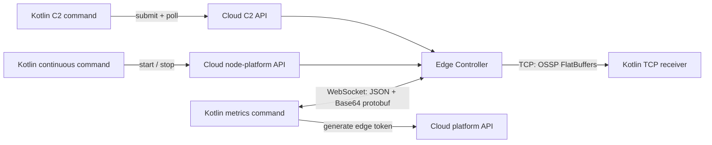

# Kotlin Node Platform — capture images and stream metrics

Three independent examples use the published Kotlin SDKs for cloud C2 and node-platform calls, plus direct LAN connections to an Edge Controller (EC) for image frames and metrics.

| Command | Behavior |
| --- | --- |
| `make c2-capture` | Submit one C2 image-capture task, poll its status, print image metadata, and download the resulting FITS file. |
| `make continuous-capture` | Start a TCP image receiver, start image streaming and continuous capture through node-platform, save five PNG frames, and stop capture and streaming. |
| `make metrics` | Obtain a node-scoped edge token, authenticate to the EC WebSocket, subscribe to the node's metrics, and print decoded samples for 30 seconds. |



## Setup

You need JDK 21, an online EC with a configured camera/optical train, and network access between this computer and the EC. Run camera examples when the selected optical train is available for manual use. The server performs its normal optical-train preparation when capture starts.

The pinned SDKs are `ai.oursky:c2.api:1.4.693`, `ai.oursky:node_platform.api:1.4.693`, and `ai.oursky:platform.api:1.4.693`. Gradle downloads them from GitHub Packages. Export `OS_GITHUB_PACKAGES_TOKEN` with a GitHub token that can read packages from `ourskyai/api`. This build credential is separate from your runtime API token; keep both out of source control.

Copy and edit the configuration, then export it into your shell:

```sh
cp .env.example .env
# Edit .env with your runtime API token, lineage UUID, optical train, and addresses.
set -a
. ./.env
set +a

make NUM_THREADS=4 build
```

`OS_API_TOKEN` must be accepted by the selected cloud environment. C2 requires `CUSTOMER_ADMIN`; the camera and image APIs require the corresponding node-platform access. `OS_LINEAGE_ID` is the node's lineage UUID, and `OS_OPTICAL_TRAIN_LABEL` selects the optical train for both capture examples. Match `OS_API_BASE_URL` to the EC's environment; it defaults to production. Adjust exposure, gain, binning, offset, and gain mode to supported camera values.

## C2 single capture

```sh
make c2-capture
```

`C2CaptureExample` sends `c2V1CaptureImage` with one optical-train selector, then polls `c2V1GetTasks` for the returned task ID. After `SUCCEEDED`, the task result contains the image ID. The example retrieves its metadata and downloads FITS using node-platform's `v1GetImage` and `v1GetImageFile` APIs. Output goes to `output/<image-id>.fits`.

The task creation response only confirms submission. Failed, cancelled, and missed tasks fail the example with their status details. `OS_TIMEOUT_SECONDS` bounds polling and individual HTTP calls. A local timeout does not cancel the cloud task; inspect or cancel the printed task ID through C2 before submitting another capture.

## Continuous capture and image stream

Set `OS_STREAM_RECEIVER_HOST` to **this computer's IP address as reachable by the EC**, and permit incoming TCP on `OS_STREAM_RECEIVER_PORT` (default `5000`). The program binds all local interfaces, then passes `tcp://<receiver-host>:<port>` to `v1StartImageStream`. The EC initiates the connection to this computer. `localhost` is only suitable when running the receiver on the EC itself. A cloud API connection does not provide a tunnel for image frames.

```sh
make continuous-capture
```

The example starts streaming before continuous capture so the receiver is ready for the first frame. It uses `enableFileSaving = false` to keep this preview session from creating image files on the EC. It saves `OS_FRAME_COUNT` frames locally (default `5`), prints their metadata, then stops continuous capture and the image stream in cleanup blocks. Socket accept/read operations use `OS_TIMEOUT_SECONDS`. Run in the foreground and let the bounded capture finish so cleanup can execute.

Each frame has a four-byte little-endian payload length followed by an `OSSP` `ImageResult` FlatBuffer. `ImageFrameReceiver` reads complete frames even when TCP splits them across packets, decodes metadata and pixels, and saves `output/<image-id>.png`. Supported layouts are mono 8-bit, mono 16-bit stored little-endian, and BGR 8-bit. PNG preserves sample values; faint astronomical images may need stretching in your image viewer. Other pixel layouts produce an explicit error.

Image streaming is **node-scoped**: starting this example selects the node's stream destination, and cleanup stops that stream. Give this example exclusive use of image streaming and the selected camera while it runs. Capture and cleanup use the same lineage and optical-train label.

## Metrics WebSocket

Set `OS_METRICS_WEBSOCKET_URL` to `ws://<ec-lan-host>:9082/`, then run:

```sh
make metrics
```

This first calls the cloud platform API's `v1GenerateEdgeToken(lineageId)` using `OS_API_TOKEN`. It then connects directly to the EC, sends the returned node-scoped JWT as an authorization message, waits for success, and subscribes. A cloud API token is not interchangeable with this edge JWT.

```json
{"type":"authorization","bearer":"<generated-edge-JWT>","headers":{}}
{"type":"subscribe","subject":"metrics.oursky.<OS_LINEAGE_ID>.>"}
```

Incoming JSON envelopes have `type: "nats"`, `subject`, and Base64 `data`. Decode Base64 first, then use `V1Metric` for subjects ending in `.v1Metric` or `V2MetricBatch` for `.v2Metrics`. The example supports both formats and prints the measurement timestamp, name, value, type, and tags, including every point in a V2 batch. This is a live subscription; it does not replay historical measurements. `OS_METRICS_SECONDS` controls how long to listen after authorization (default `30`).

Run metrics in a second terminal while exercising either capture command. The LAN image and WebSocket paths use plain TCP; use them on a network that can reach the EC and receiver.

## Source layout and binary schemas

`Main.kt` selects the command. `ExampleConfiguration` reads environment variables, and `ExampleClients` creates authenticated SDK clients. Each example class owns its scenario's execution and cleanup; `ImageFrameReceiver` owns frame decoding and PNG output.

The FlatBuffers schemas in `flatbuffers/` are copied from `node-controller/hw-daemon/flatbuffers/`. Generated Java tables in `src/main/java/hwdaemon/` were produced with `flatc 2.0.0` and are included so normal builds do not need the compiler. To regenerate after updating schemas, install that compiler version and run from this directory:

```sh
flatc --java -o src/main/java flatbuffers/*.fbs
```

`src/main/proto/metrics.proto` is copied from `node-controller/protos/common/metrics.proto`. Gradle generates its Java decoder classes using pinned `protoc 3.21.12`. Update schema copies when the EC wire contracts change.

## Validation

```sh
make NUM_THREADS=4 test
```

Tests use local HTTP/WebSocket fixtures and generated binary frames to exercise C2 polling/download, continuous-capture cleanup, partial TCP reads, image pixel preservation, and both metric formats. They do not contact cloud services or operate hardware.

The equivalent direct Gradle command is `./gradlew --max-workers=4 run --args=metrics` (replace `metrics` with either capture command).
