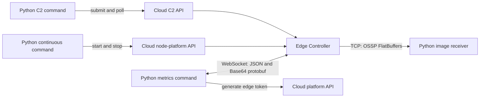

# Python Node Platform — capture images and stream metrics

Python equivalents of the three [Kotlin node-platform examples](../kotlin-node-platform), plus the existing read-only status/mount-model example. Every run requires an explicit command.

| Command | Behavior |
| --- | --- |
| `make status` | Print system status and the current mount model. |
| `make c2-capture` | Submit one C2 capture task, poll its status, and print the image ID; the file stays on the node. |
| `make continuous-capture` | Start a TCP image receiver, start streaming and continuous capture, save five PNGs, and stop capture and streaming. |
| `make metrics` | Obtain an edge token, authenticate to the EC WebSocket, and print decoded metrics for thirty seconds. |



## Setup

Use Python 3.10 or newer and install FlatBuffers `flatc 25.12.19`. Run these commands from this directory:

```sh
python3 -m venv .venv
. .venv/bin/activate
python -m pip install -r requirements-dev.txt
make schemas
cp .env.example .env
# Edit .env with your runtime API token, lineage UUID, optical train, and addresses.
python main.py --help
```

The program loads `.env` automatically; exported variables take precedence. `OS_API_TOKEN` and `OS_LINEAGE_ID` are required for every command. `OS_API_BASE_URL` defaults to `https://api.prod.oursky.ai`; match it to the EC's environment. The previous Python variable `OS_NODE_PLATFORM_BASE_URL` remains a fallback when `OS_API_BASE_URL` is unset. Keep credentials out of source control.

The base URL must include `http://` or `https://`. For `c2-capture`, use the cloud C2 API (`https://api.prod.oursky.ai` or `https://api.dev.oursky.ai`) or a self-hosted API that serves `/c2/v1/`. The EC's local web server does not serve the cloud C2 API. A `405` response naming the `web-client` servlet means the request reached the UI handler rather than C2; check the server address and API base path.

The three published SDKs are pinned to `1.4.746`. C2 requires `CUSTOMER_ADMIN`; other calls require the corresponding platform/node-platform access. Camera commands also require an online EC and a configured, available optical train selected by `OS_OPTICAL_TRAIN_LABEL`. Set exposure, gain, binning, offset, and gain mode to supported camera values. The server performs its normal optical-train preparation when capture starts.

`python main.py` without a command prints usage and exits. The existing example is now `python main.py status`. All Make targets also accept `PYTHON=.venv/bin/python` if you prefer not to activate the virtual environment.

## C2 single capture

```sh
make c2-capture
# Equivalent: python main.py c2-capture
```

`C2CaptureExample` submits one optical-train selector using `c2_v1_capture_image`, prints the returned task ID, and polls that exact ID using `c2_v1_get_tasks`. After `SUCCEEDED`, it prints and returns the image ID from the task result. The image file is stored locally on the node, so the command ends without calling `v1_get_image` or `v1_get_image_file` through the cloud API.

Submission confirms acceptance. Failed, cancelled, and missed tasks fail the command with their status details. `OS_TIMEOUT_SECONDS` defaults to `120` and bounds polling and individual HTTP calls. A local timeout does not cancel the cloud task; inspect or cancel the printed task ID through C2 before submitting another capture.

## Continuous capture and image stream

Set `OS_STREAM_RECEIVER_HOST` to this computer's address as reachable by the EC and permit incoming TCP on `OS_STREAM_RECEIVER_PORT` (default `5000`). The program binds all local IPv4 interfaces, advertises `tcp://<receiver-host>:<port>`, and waits for the EC to connect. Use `localhost` only if the receiver runs on the EC. Cloud connectivity does not provide a tunnel for image frames.

```sh
make continuous-capture
```

The receiver listens before the command starts streaming, then capture. It saves `OS_FRAME_COUNT` frames (default `5`) to `output/<image-id>.png`, prints metadata, and attempts to stop capture and streaming during cleanup. Socket accept/read operations use `OS_TIMEOUT_SECONDS`. Run in the foreground so cleanup can execute.

The SDK's continuous-capture request sets `enable_file_saving=False`, sending `enableFileSaving: false` to match Kotlin's preview behavior. Use an EC version supporting that field; an older EC may ignore it and save captures.

Each frame contains a four-byte little-endian payload length followed by an `OSSP` `ImageResult` FlatBuffer. `ImageFrameReceiver` reads complete frames across partial TCP reads and supports mono 8-bit, little-endian mono 16-bit, and BGR 8-bit pixels. PNG preserves sample values; faint astronomical images may need stretching in your viewer. Other layouts fail explicitly. `OS_OUTPUT_DIRECTORY` changes the continuous-capture output directory.

Image streaming is node-scoped: starting the command changes the node's stream destination, and cleanup stops that stream. Give the example exclusive use of image streaming and the selected camera while it runs. Capture and cleanup use the same lineage and optical-train label. Cleanup attempts both stop calls; if receiving or capture already failed, cleanup failures are logged while the original failure remains the command's error.

## Metrics WebSocket

Set `OS_METRICS_WEBSOCKET_URL` to `ws://<ec-lan-host>:9082/`, then run:

```sh
make metrics
```

`MetricsStreamExample` calls the cloud platform API's `v1_generate_edge_token` with the selected lineage. It connects directly to the EC, sends the node-scoped JWT, waits up to fifteen seconds for the authorization reply, and subscribes after successful authorization. The EC may send a `welcome` message first; the example skips it while waiting for the authorization reply. The cloud API token is not interchangeable with the edge JWT.

```json
{"type":"authorization","bearer":"<generated-edge-JWT>","headers":{}}
{"type":"subscribe","subject":"metrics.oursky.<OS_LINEAGE_ID>.>"}
```

Incoming `nats` JSON envelopes contain `subject` and Base64 `data`. The command decodes `.v1Metric` as `V1Metric` and `.v2Metrics` as `V2MetricBatch`, printing timestamps, names, values, types, and tags for every point. `OS_METRICS_SECONDS` controls listening time after authorization (default `30`). This is a live subscription without historical replay or reconnection. Authentication, decoding, or an early disconnect fails the command.

Run metrics in a second terminal while exercising capture. LAN image streaming and the example WebSocket use plain TCP on a network that can reach the EC and receiver.

## Source layout and schema regeneration

`main.py` selects the command. `ExampleConfiguration` reads environment variables; `ExampleClients` owns the authenticated SDK clients. Each scenario class owns its execution and resource cleanup. No event loop or background receiver worker is needed.

The schemas in `flatbuffers/` and `proto/metrics.proto` are copied unchanged from the Kotlin example. Generated `hwdaemon/` and `generated/` files are ignored by Git. Generate them before the first run and whenever the schemas change, using FlatBuffers `flatc 25.12.19` and the pinned development dependencies:

```sh
python -m pip install -r requirements-dev.txt
make schemas
```

This uses `flatc --python -o . flatbuffers/*.fbs` and `python -m grpc_tools.protoc -I proto --python_out=generated proto/metrics.proto`. FlatBuffers `2.0.0`, used by Kotlin's Java generator, cannot generate Python bindings for the optional scalar in this schema. Generated protobuf code requires the pinned compatible runtime. Update schema copies and generated bindings when the EC wire contracts change.

## Validation

```sh
python -m pip install -r requirements-dev.txt
make schemas
make test
```

Tests use localhost HTTP/TCP/WebSocket fixtures and generated binary frames. They cover C2 polling and completion without image lookups or downloads, continuous-capture cleanup, fragmented frames, PNG sample preservation, both metrics formats, authorization, CLI selection, and the retained status example. They do not contact cloud services or operate hardware.
